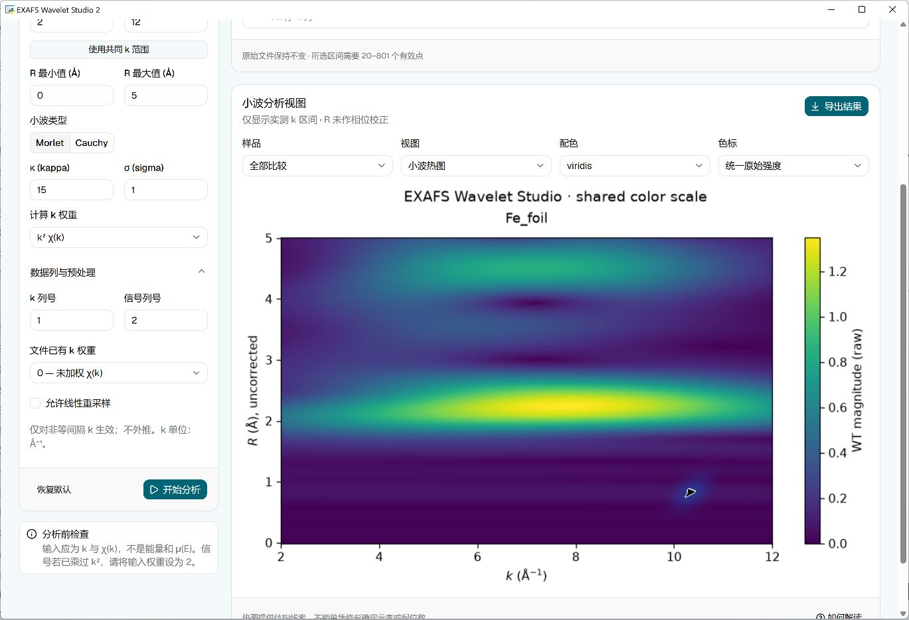
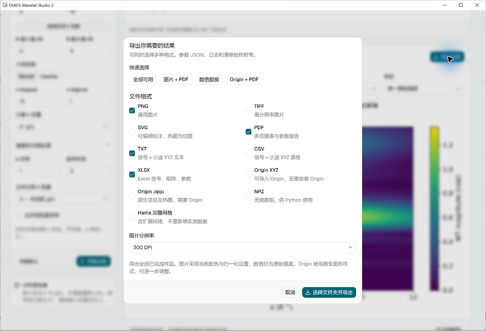

# EXAFS Wavelet Studio

中文说明 · [English](README.md)

面向 Hama 小波变换 EXAFS 分析的 Windows 桌面软件。提供官方 shadcn/ui 界面、中英文切换、本机计算、详细错误指导和可组合的多格式导出。

**Hama 由用户独立获取。** 本仓库和安装包不含 Hama、原版 Wgnuplot、官方手册或模型文件。MIT 许可证适用于本软件自有代码，不把 Hama 或其他第三方组件重新授权为 MIT。

## 跟着图片操作

**[中文详细图文教程](docs/TUTORIAL.zh-CN.md)** · [English tutorial](docs/TUTORIAL.en.md) · [问题反馈 / 功能建议](https://github.com/369di-cmyk/exafs-wavelet-studio/issues)

从安装、Athena 导出、列号和权重、参数选择到 Origin / Excel / PDF 导出，一步一步说明。

## 2.1.0 图文教程与 Athena 导入

打开软件顶部 **说明 / Guide**，即可查看中英文图文教程：Athena 导出菜单、实际 .chik 七列格式、两个权重的区别、参数初始值与调整方法、视频截图时间点和常见报错处理。图片可点击放大，离线可看。原视频与官方文档入口在教程末尾。

推荐从 Athena 的 **File → Save current group as… → χ(k)** 导出 `.chik`，直接导入。第1列 k、第2列 χ，输入权重0，计算权重通常从2开始；对照视频 k³χ 路线时计算权重改3。不要把 Athena.kweight 文件头误认为第2列已有权重。不要直接导入 .prj 或 μ(E)。

修复了文件选择框遗漏 `.chik` 的问题，加入 `.xdi` 文本筛选；保留2.0.2下载重试/缓存/下载文件夹检测及2.0.1 Origin方向修复。下载与教程入口见下方。

视频来源：[一分钟速成Wavelet-transform](https://www.bilibili.com/video/BV1Xsy7YRETN/)，画面水印“倩儿的天使师兄”。节选截图不适用MIT；详见第三方说明。

## 2.0.2 一键配置改进（已包含）

“一键配置 Hama”会先校验并复用本机引擎，再检测下载文件夹中的已完成 Hama ZIP/EXE，最后才联网下载。官网连接失败时最多尝试 3 次，显示下载进度并支持取消。证书、域名解析、HTTP 拒绝、超时及不完整文件分别给出解决方法。

若官网仍拒绝自动下载：点 **官网下载链接 → 浏览器下载完成 → 检测下载并导入**，不用解压或找程序文件。另存到其他位置时用“导入 ZIP / EXE”。成功配置后可离线使用。最近一次配置记录保存在本机缓存的 `last_download.json`。改进已包含在 2.1.0。

## 2.0.1 坐标修正（已包含）

本源码和本地修正版已修复 2.0.0 的 Origin 原生项目矩阵转置问题。统一横轴为 k（Å⁻¹）、纵轴为未相位校正的 R（Å），矩阵列=k、行=R。旧版 `.opju` 请用修正版重新导出；仅改轴标题或旋转图片不能修复数据坐标。预览、图片/PDF、Excel、TXT/CSV 和 Origin XYZ 不受该问题影响。修正已包含在 2.1.0。

## 下载 v2.1.0

- **[Windows 安装程序（推荐）](https://github.com/369di-cmyk/exafs-wavelet-studio/releases/download/v2.1.0/EXAFS_Wavelet_Studio_2.1.0_Setup.exe)**
- [Windows 便携 ZIP](https://github.com/369di-cmyk/exafs-wavelet-studio/releases/download/v2.1.0/EXAFS_Wavelet_Studio_2.1.0_Windows.zip) · [源码 ZIP](https://github.com/369di-cmyk/exafs-wavelet-studio/releases/download/v2.1.0/EXAFS_Wavelet_Studio_2.1.0_Source.zip)
- [版本说明与所有下载](https://github.com/369di-cmyk/exafs-wavelet-studio/releases/tag/v2.1.0)

安装后在“ Hama 引擎”页一键下载或导入 Hama。原生 Origin 项目导出需要本机安装并激活 Origin。

## 三步开始

1. 双击安装程序安装，或完整解压便携 ZIP 后打开 `EXAFS_Wavelet_Studio.exe`。
2. 在 **Hama 引擎 → 一键下载并配置** 中准备引擎。已有 `hama_1.zip`、`hama_fortran.exe` 或文件夹时，可直接导入。软件自动校验并存到本机缓存，以后不依赖原文件的位置。
3. 导入包含 **k（Å⁻¹）和 χ(k)** 的 CHIK/CHI/XDI/TXT/DAT/CSV，检查列号、输入已有 k 权重和分析范围，点击 **开始分析**。完成后点 **导出结果**，勾选需要的格式并选择保存文件夹。

也可先载入内置演示；演示为合成信号，**不是实验数据**。

运行环境：Windows 10/11 64 位、.NET Framework 4.8、Microsoft Edge WebView2 Runtime。当前 Windows 通常已具备；若窗口无法启动，启动器会说明 WebView2 的安装办法。[Microsoft 官方 WebView2 页面](https://developer.microsoft.com/microsoft-edge/webview2/)。使用打包版本不必安装 Python 或 Node.js，安装器不要求管理员权限。Hama 配置完成后，分析和常规导出可离线使用。

## 官方主页与下载地址

- [Hama 官方主页、原作者说明和引用信息](https://www.esrf.fr/UsersAndScience/Experiments/CRG/BM20/Software/Wavelets/HAMA)
- [ESRF 官方 Hama ZIP 下载](https://www.esrf.fr/files/live/sites/www/files/UsersAndScience/Experiments/CRG/BM20/Software/Wavelets/HAMA/hama_1.zip?download=1)

官方页面列出的作者为 Harald Funke 和 Marina Chukalina。论文引用请遵循其官方说明。本软件不是 ESRF 或 OriginLab 官方产品，也不提供 Hama 镜像。

当前适配版本的 `hama_fortran.exe` SHA-256：`f8fa901ca98bee23113d88e9864ed64ece6aa0c9982d1d6a9a4d360e07f8b054`。损坏、被修改或尚未适配的新版引擎不会执行。官网或网络可能限制自动下载，此时可在浏览器下载后导入，不需要手动解压。

## 路径问题怎样解决

官网明确要求 **等间隔采样**。旧引擎也会从当前工作目录查找文件，但公开网页没有明确声明“一切中文路径都不支持”。本软件按旧程序的兼容性需求处理：

- 每个任务单独建立可写、无空格、短英文工作目录。
- 将引擎和准备后的输入复制进去，以短英文相对文件名运行。
- 绘图由本软件生成，用自有轻量辅助程序处理旧版绘图调用，不附带原版 Wgnuplot。
- 任务结束后清理临时目录；原始文件不改动。
- 用户数据和导出目录可以有中文、空格，软件与数据无需同目录，也可位于不同磁盘。
- 如果账户路径无法生成英文短路径且备用位置不可写，可在“引擎”中指定例如 `D:\EXAFSWork` 的目录，错误窗口会给出具体原因。

支持每批最多 8 个样品，所选区间每个样品 20–801 个点。这是本适配器为运行时间和内存设置的边界，不声称是 Hama 的通用上限。程序检查 k 递增、缺失值、列号、权重、范围和步长；线性重采样必须主动勾选，会记录在结果中，且不外推。取消和超时只终止本次任务进程。导出或安装时请等待完成再关窗口；计算中关窗口会先请求取消，结束后再关闭。

## 可选导出格式

| 格式 | 内容 | 是否需要 Origin |
|---|---|---|
| PNG / TIFF / SVG | 单样品小波图与对比图；适用时可选 150/300/600 DPI | 不需要 |
| PDF | 多页小波图、加权信号、参数与解读注意事项 | 不需要 |
| TXT / CSV | 准备后的信号和实测区间内的小波 XYZ 数值 | 不需要 |
| Excel `.xlsx` | 总览、每个样品的信号表、R×k 矩阵、参数表 | 不需要 |
| Origin XYZ | 可导入 Origin 的三列文本 | 不需要 |
| Origin `.opju` | 真正的项目文件：信号工作表、小波矩阵、可编辑原生热图 | **需要** |
| NPZ | Python 可读取的无损数值数组 | 不需要 |
| Hama 完整网格 | 含超出实测 k 区间的扩展部分 | 不需要 |

格式可任意组合，例如仅 PDF、仅 Origin、Origin + PDF、TXT + Excel 或全部可用。每次导出创建独立目录，不覆盖上次结果，始终附带参数 JSON、运行日志和导出清单。某种格式失败会明确报告，其他成功文件仍保留，不会把 TXT 改后缀冒充 `.opju`。

原生 OPJU 需要安装并激活 Origin 2018 或更新版本；已在本机 Origin 2021 上验证。导出使用独立实例，不连接或覆盖当前已打开的 Origin 项目。Origin 图形采用其原生样式，与软件图片可能不同，比较不同样品时请在 Origin 中统一色标。标准数值导出始终保留原始强度；图片遵循当前配色和归一化设置，原始强度单图使用整批统一最大值。SVG 标注可编辑，密集热图采用位图嵌入。

## 科学使用注意事项

1. 先用 Athena 等软件完成背景扣除并提取 χ(k)。本软件不代替 μ(E) 的预处理。
2. 若输入为 k²χ(k)，将“文件已有 k 权重”设为 2，避免重复加权。
3. R 未作相位校正，小波峰位不等于精确键长，也不能单凭热图确认元素、价态或配位数。应结合标准样品、EXAFS 拟合及其他证据。
4. 比较样品时统一预处理、小波参数、k 权重、k/R 范围与色标。各样品归一化仅用于比较形状。
5. 有限 k 区间会引入边界伪影；更平滑、更鲜艳的图不是额外的实验信息。
6. 完整 Hama 网格含延伸部分，不是新增实测数据。标准视图和常规数值导出已限制在实测 k 区间。

## 出错时怎么办

错误窗口会分别显示 **哪里出错、为什么、如何修改、错误编号**，并可展开原始细节和复制诊断。

| 错误 | 处理方法 |
|---|---|
| 官网下载失败 / HTTP 403 | 浏览器打开官网下载链接，再导入 ZIP；检查网络或代理，原有有效引擎会保留。 |
| Hama 校验失败 | 重新下载官方版本。若官网已更新二进制，需要维护者验证适配，不应绕过校验。 |
| k 不等间隔 | 检查数据后主动启用线性重采样，或在上游软件按等间隔重新导出。 |
| k 范围超出数据 | 使用“共同 k 范围”，或将边界调整到每个样品实测区间内。 |
| 非数字 / 空单元格 | 按提示的文件行号修正数据，统一分隔符和列数。 |
| 工作目录不可用 | 选择可写的短英文目录，无需移动原始数据。 |
| Origin 导出不可用 | 先安装并激活合适版本，关闭许可提示后重试；也可导出 PDF、Excel 或 XYZ。 |
| 写入被拒绝 | 关闭占用文件的程序，检查空间和权限，改用可写目录。 |

配置和引擎缓存在 `%LOCALAPPDATA%\EXAFSWaveletStudio`。软件不自动上传实验数据或诊断信息；只有用户点击下载和外部链接时访问网络。分享日志前检查私人路径。

安装器采用当前用户安装，不注册 Windows“已安装的应用”卸载项。移除时先退出软件，再删除安装文件夹和对应的桌面、开始菜单快捷方式即可；这不会删除配置、Hama 缓存或另存的结果。需要彻底清除时，可另外删除上述缓存目录。升级请使用新版本文件夹，安装器不会覆盖已有目录。

## 开发、构建与开源发布

需要 Python 3.12 64 位、Node.js 24 LTS/npm。开发及测试命令见 [English README](README.md#development-and-testing)。本仓库包含前端源码、Python 后端、自有绘图辅助程序源码、安装器源码、测试与 GitHub Actions 检查。

自有代码使用 [MIT 许可证](LICENSE)，第三方组件保留各自许可，见 [第三方说明](THIRD_PARTY_NOTICES.md)。发布时使用整理好的源码 ZIP 或 `scripts/package_release.py` 的明确白名单，不要把旧 v1 包、Hama 缓存、实验数据、虚拟环境、测试输出或其他项目直接上传。数值测试夹具为合成数据及参考结果，不含 Hama 程序代码。

实际完成的测试和边界见 [TEST_REPORT.md](TEST_REPORT.md)，更新记录见 [CHANGELOG.md](CHANGELOG.md)。

## 视频来源、致谢与反馈

特别感谢哔哩哔哩 UP 主 **倩儿的天使师兄** 分享[《一分钟速成Wavelet-transform ▏XAS同步辐射-小波变换处理EXAFS数据》](https://www.bilibili.com/video/BV1Xsy7YRETN/)。本软件图文教程引用了部分画面，并保留原作者署名和时间点。想看完整讲解，请前往博主的原视频页面观看；也可在视频页点击 UP 主名字进入其主页，查看更多内容并支持原作者。

- [本软件 GitHub 项目主页](https://github.com/369di-cmyk/exafs-wavelet-studio)
- [查看已有反馈](https://github.com/369di-cmyk/exafs-wavelet-studio/issues)
- [反馈问题或提出新功能建议](https://github.com/369di-cmyk/exafs-wavelet-studio/issues/new)

软件“使用说明”页还提供“反馈问题”和“建议新功能”按钮，自动打开带填写提纲的页面。问题反馈请提供版本、重现步骤、错误编号和截图；功能建议请描述使用场景和希望的效果。登录 GitHub 后自行确认提交，分享前移除私人路径和未公开的实验数据。
