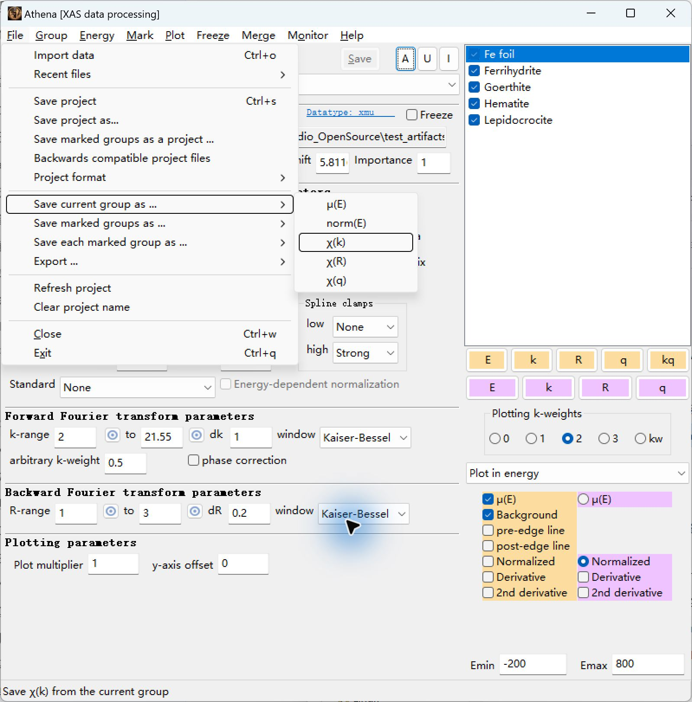
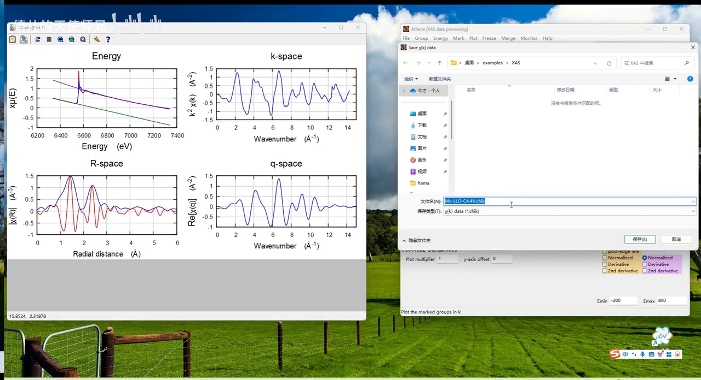
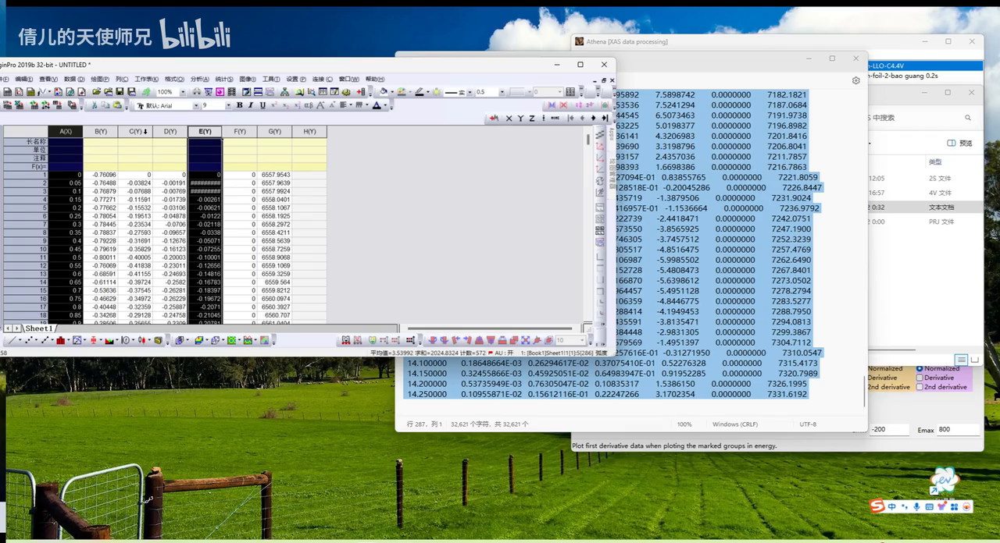
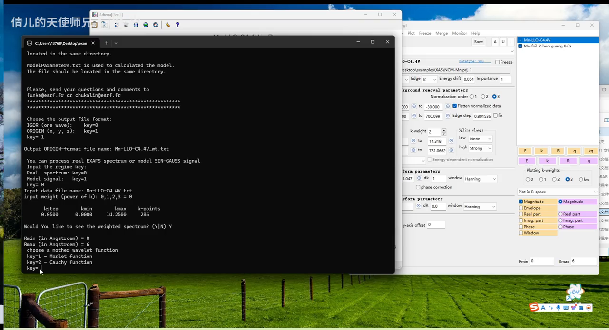
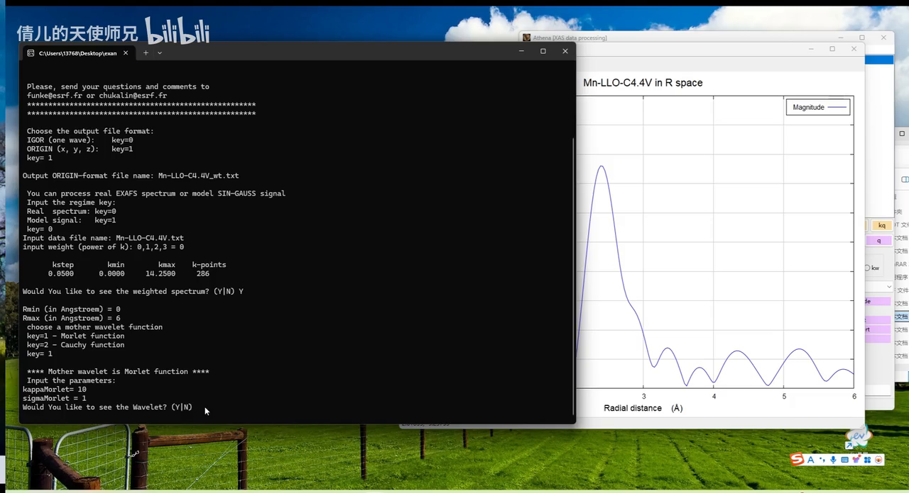
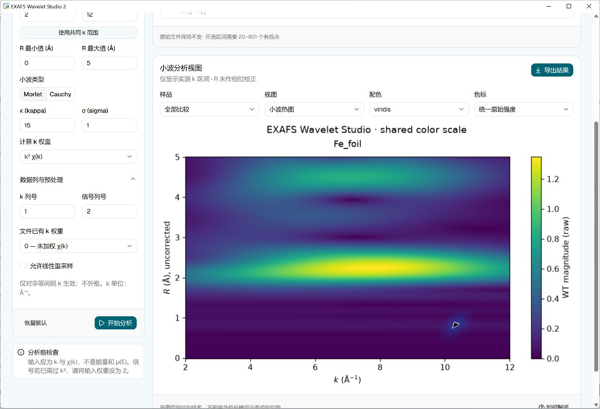
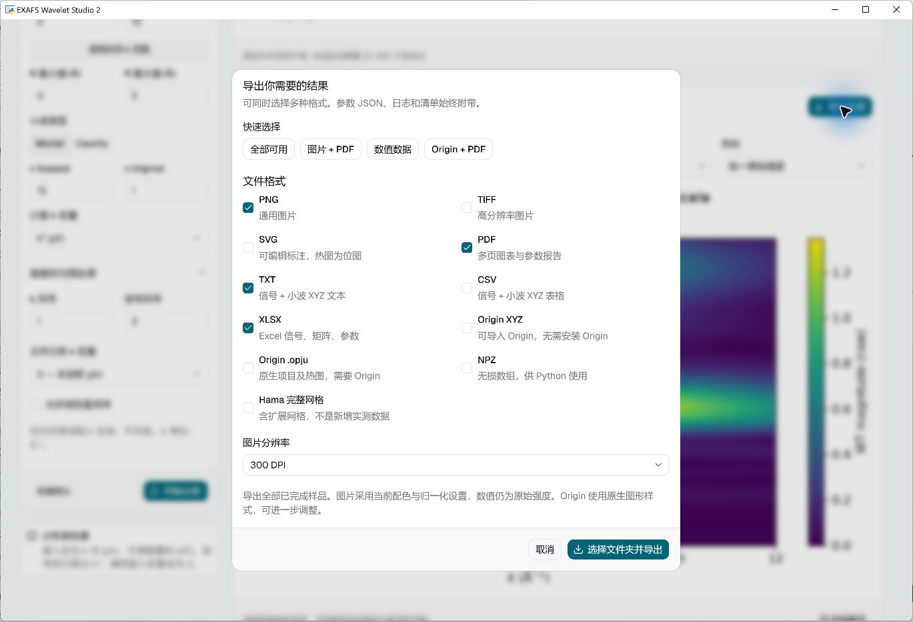

# Illustrated guide: Athena to wavelet plots

[Project home](../README.md) · [中文完整教程](TUTORIAL.zh-CN.md) · [Downloads](https://github.com/369di-cmyk/exafs-wavelet-studio/releases/latest)

For EXAFS Wavelet Studio 2.1.0 on Windows 10/11 x64. The packaged app needs no Python or Node.js. Start with background-subtracted χ(k); this app provides visual Hama configuration, analysis and image, Excel and Origin exports.

## Credit and thanks

Thank you to Bilibili creator **倩儿的天使师兄**, credited by the on-screen watermark, for sharing **一分钟速成Wavelet-transform ▏XAS同步辐射-小波变换处理EXAFS数据**. [Watch the complete original video and support its creator](https://www.bilibili.com/video/BV1Xsy7YRETN/). On the video page, click the creator's name to visit their profile. This companion guide does not replace the full explanation. Excerpts retain their original watermark and are excluded from this project's MIT license; see [third-party notices](../THIRD_PARTY_NOTICES.md).

## 1. Install and configure Hama

Download the installer from [Releases](https://github.com/369di-cmyk/exafs-wavelet-studio/releases/latest), or extract the **entire** portable ZIP before running the EXE. Open Hama engine and choose one-click configuration. It checks the verified cache, then completed Downloads files, then the official server with up to three attempts.

If downloading fails, use **Official download**, finish the download in your browser, then **Detect download & import**. No ZIP extraction is needed. Import ZIP / EXE handles files saved elsewhere. Once ready, calculation works offline. Hama is acquired separately and is not bundled.

[Official Hama page](https://www.esrf.fr/UsersAndScience/Experiments/CRG/BM20/Software/Wavelets/HAMA) · [Official ZIP](https://www.esrf.fr/files/live/sites/www/files/UsersAndScience/Experiments/CRG/BM20/Software/Wavelets/HAMA/hama_1.zip?download=1)

Your data and exports may use Chinese characters/spaces and need not share the app folder. The adapter prepares short ASCII work paths while preserving original files. If automatic work-folder selection fails, choose a writable location such as `D:\EXAFSWork` in the engine page.

## 2. Export χ(k) from Athena

Finish energy calibration, normalization and background subtraction. Select the sample and inspect χ(k) for usable signal and noisy tails. Choose **File → Save current group as… → χ(k)** and save `sample.chik`. Do not import μ(E), χ(R), χ(q), or a `.prj` project as χ(k).

*Local Athena 0.9.26 test with the bundled Fe foil standard. This command exports the current selected group.*

*Original video 00:52: the default extension is `.chik`. No renaming to `.txt` is needed.*

Export samples individually. “Save marked groups as” can combine groups into a different column layout; do not assume the mapping below applies to that command.

## 3. Import and select columns and weights

Choose Import data and open `.chik`. Our actual export had 441 rows, seven columns and k=0–22 Å⁻¹ at 0.05 spacing; **your data range will differ**. Inspect its header before choosing columns (numbered from 1).

| Column | Contents | Input-data weight if selected as signal |
|---|---|---|
| 1 | k | Use as k column |
| 2 | Unweighted χ(k) | 0 |
| 3 | kχ(k) | 1 |
| 4 | k²χ(k) | 2 |
| 5 | k³χ(k) | 3 |
| 6 | FT window | Not a χ signal |
| 7 | Energy | Neither k nor χ |

Check `Column.1/Column.2`. The `Athena.kweight=2` header does **not** make column 2 weighted. A simple starting setup is **k column 1, signal column 2, input-data weight 0, calculation weight 2**. The app removes the selected signal's existing power of k before applying the requested calculation weight.

*Original video 01:38: A/E are k and k³χ. This app can select them directly without copying through Origin.*

| Route | k column | Signal column | Input-data weight | Calculation weight |
|---|---:|---:|---:|---:|
| Calculate k²χ from raw χ | 1 | 2 | 0 | 2 |
| Match the video's final k³χ from raw χ | 1 | 2 | 0 | 3 |
| Use the video's preweighted column | 1 | 5 | 3 | 3 |

The video's native Hama **weight=0** adds no further power to already-weighted k³χ. It is not the same field as this app's input-data weight. Use 3/3 here for that route.

## 4. Set parameters

These are starting values, not universal optima. Use consistent preprocessing, ranges, weights, wavelet parameters and color scales across samples.

| Parameter | App initial value | Selection guidance |
|---|---|---|
| k range | 2–12 Å⁻¹ | Choose usable signal within actual measured support. The video's 14.25 limit is not a requirement for your data. |
| R range | 0–5 Å | Adjust for the region of interest; video uses 0–6. R is not phase corrected. |
| Mother wavelet | Morlet | Useful for following the video; Cauchy is an alternative analysis choice. |
| Morlet κ / σ | 15 / 1 | Hama's overview example uses κ=15; video uses 10/1. These affect the k/R resolution trade-off. Check feature stability under modest changes. |
| Cauchy n | 50 | Only used with Cauchy; an app default, not a video recommendation. |
| Calculation weight | 2 | Use 3 for the video route. Higher powers also amplify high-k noise. |
| Resampling | Off | Tested Athena export is uniform. Enable only when interpolation of irregular sampling is intended; it is logged and never extrapolates. |

*Original video 05:50: R=0–6 Å, followed by Morlet selection.*

*Original video 06:55: Morlet κ=10, σ=1. These belong to the demonstrated example.*

## 5. Analyze and inspect

Click Analyze and wait. Common k range can help with multiple samples, but still check signal quality. The adapter supports up to eight samples per batch and 20–801 selected points per sample.

*Local Athena Fe foil export processed in the app, not a borrowed paper plot.*

Horizontal axis is **k (Å⁻¹)** and vertical axis is **uncorrected R (Å)**. Matrix columns=k and rows=R. A hotspot alone does not establish element identity, oxidation state or coordination number. R peaks are not exact bond lengths; boundary artifacts and normalization also matter. Combine this with standards, EXAFS fitting and other evidence.

Version 2.1.0 includes the native Origin matrix-orientation correction. Re-export old 2.0.0 `.opju` files; rotating an image or changing axis labels does not fix data coordinates.

## 6. Export

Click Export, select one or more formats and choose a destination. Each export creates a new folder with settings, logs and a manifest, preserving earlier exports.

| Purpose | Format | Notes |
|---|---|---|
| Figures | PNG / TIFF / SVG | 150/300/600 DPI where applicable. Dense SVG heatmaps are raster-embedded; annotations remain editable. |
| Report | PDF | Wavelet plots, signal and parameters. |
| Excel analysis | XLSX | Signals, R×k matrices and settings. |
| Text interchange | TXT / CSV | Signal and wavelet XYZ values. |
| Plot later in Origin | Origin XYZ | X=k, Y=R, Z=WT; no local Origin needed to export. |
| Editable Origin project | OPJU | Requires locally installed, activated Origin; tested with Origin 2021. |
| Further coding | NPZ | Lossless arrays. |
| Full engine output | Hama full grid | Includes extensions beyond measured k; not extra measured data. |

For example, select **Origin + PDF + Excel** together. Standard numerical exports retain unnormalized intensity; figures follow display settings. Origin uses its own native plot style, so align color scales when comparing samples. A partial export retains successful files and reports failed formats.

## Troubleshooting

| Symptom | Cause and action |
|---|---|
| Hama download fails | Read the code for timeout, DNS, TLS, HTTP denial or incomplete files. Use the official browser download and detect/import it after completion. An error HTML page is not a ZIP. |
| Unsupported engine/hash mismatch | File may be damaged or a different version. Obtain the official supported file; mismatched engines are not executed. |
| Cannot select `.chik` | Use the 2.1.0 picker and verify Athena saved the file. Renaming is unnecessary. |
| Not k data | Check for an energy column, μ(E) file or `.prj`. Export current-group χ(k) and recheck columns. |
| Range/point-count error | Stay within measured support with 20–801 selected points. Do not invent missing measurements. |
| Irregular/non-increasing k | Inspect missing/duplicate points; resample only intentionally. |
| Work folder unavailable | Select a writable short ASCII directory. |
| Origin export fails | Verify Origin starts and is activated; use XYZ, Excel or PDF meanwhile. Never rename text as OPJU. |
| App will not open | Check Windows, .NET 4.8 and WebView2; follow the launcher's component instructions. |

The error panel explains the location, cause, correction and code, with copyable diagnostics.

## Feedback and feature requests

[Repository](https://github.com/369di-cmyk/exafs-wavelet-studio) · [Issues](https://github.com/369di-cmyk/exafs-wavelet-studio/issues) · [New feedback](https://github.com/369di-cmyk/exafs-wavelet-studio/issues/new)

The app Guide has Report a problem and Suggest a feature buttons with prefilled outlines. Include app version, steps, error code and screenshot for bugs; use case and desired inputs/outputs for features. Remove private paths and unpublished research before sharing. You review and submit the form yourself on GitHub.

This guide uses local Athena/Hama/Origin tests, [official Athena documentation](https://bruceravel.github.io/demeter/documents/Athena/output/column.html), Hama documentation and the credited video. The supplied [Huasuan article](https://www.huasuankeji.com/news/?p=349505) remained behind site verification and its body was not treated as verified evidence. See [test records](../TEST_REPORT.md) for scope. Software verification does not independently validate scientific interpretation.
