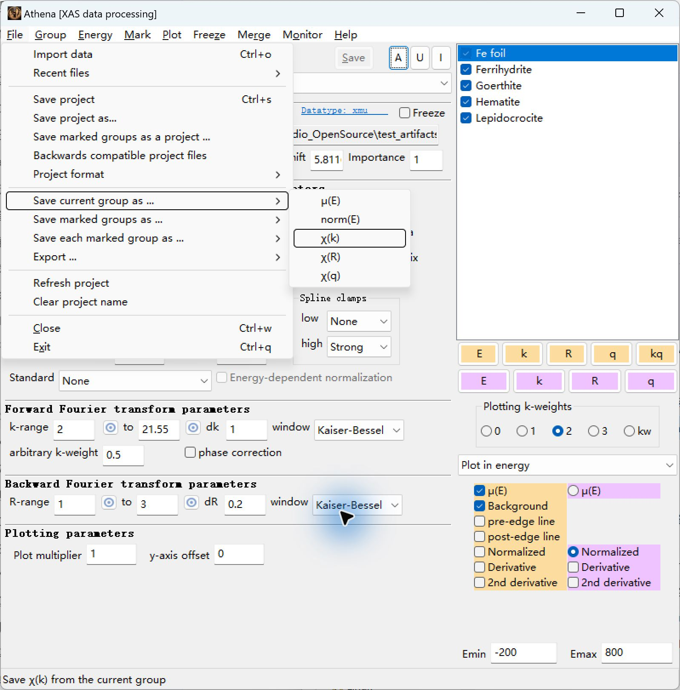
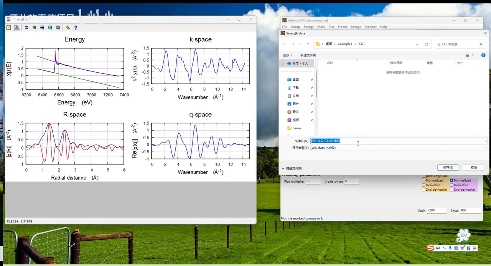
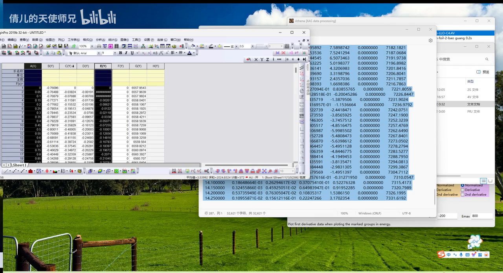
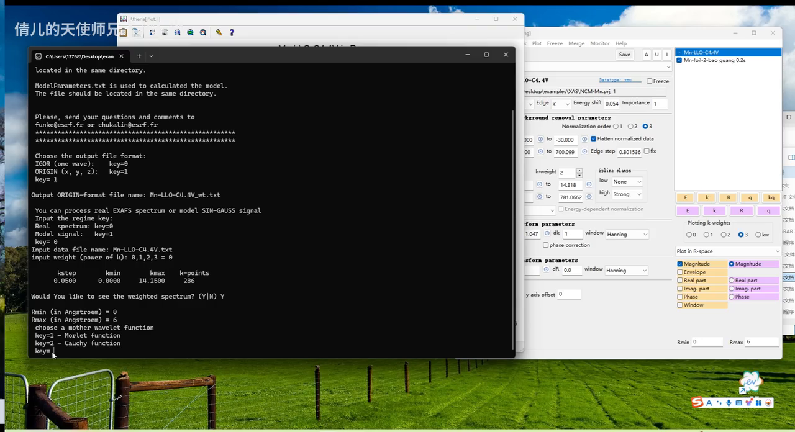
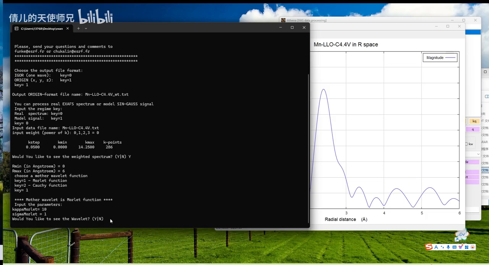
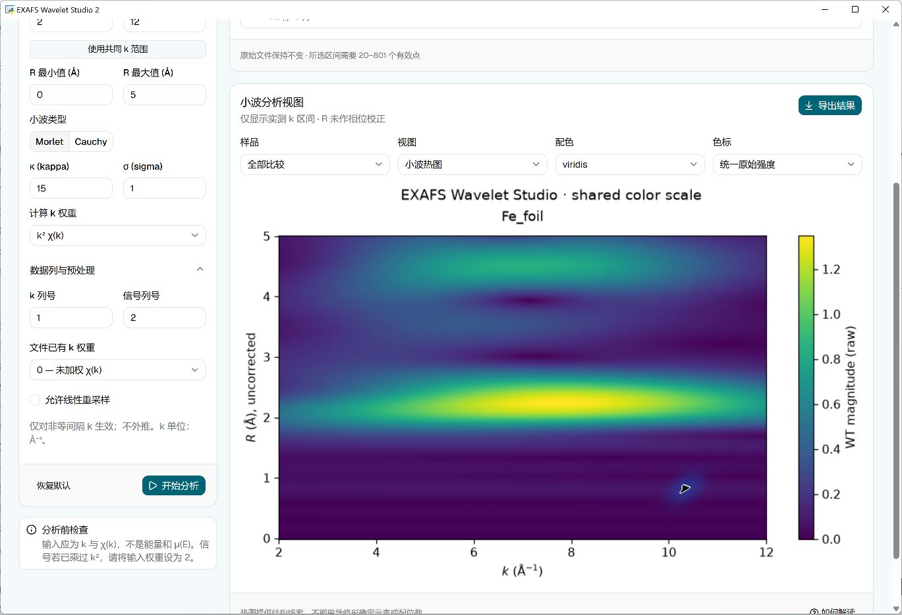
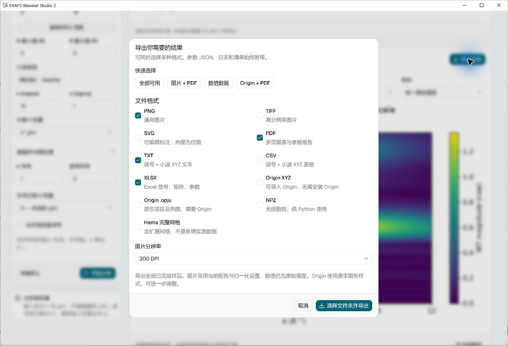

# 从 Athena 到小波图：一步一步操作

[返回项目首页](../README.zh-CN.md) · [English tutorial](TUTORIAL.en.md) · [下载软件](https://github.com/369di-cmyk/exafs-wavelet-studio/releases/latest)

适用版本：EXAFS Wavelet Studio 2.1.0，Windows 10/11 64 位。打包版不需要安装 Python、Node.js。本教程从已经完成背景扣除的 χ(k) 开始；软件把原先需要准备文件、输入命令的小波计算做成了可视化流程，并可直接导出图片、Excel 和 Origin 数据/工程。

## 视频来源与特别感谢

感谢 B 站 UP 主 **倩儿的天使师兄** 分享《一分钟速成Wavelet-transform ▏XAS同步辐射-小波变换处理EXAFS数据》！本教程参考其中的操作过程，并保留节选截图的原水印。署名依据视频画面水印。

**[点击观看完整原视频，并支持原作者](https://www.bilibili.com/video/BV1Xsy7YRETN/)**。进入视频页面后，点击 UP 主名字可访问其主页、观看更多内容。下面是软件配套说明，不能代替博主的完整讲解。视频截图不属于本项目 MIT 授权范围，版权归原权利人；其余来源见[第三方说明](../THIRD_PARTY_NOTICES.md)。

## 1. 安装软件并准备 Hama

1. 从 [Releases](https://github.com/369di-cmyk/exafs-wavelet-studio/releases/latest) 下载 `Setup.exe`，双击安装。也可下载 Windows ZIP，**完整解压**后运行 EXE。不要只从 ZIP 中拖出一个 EXE。
2. 打开 **Hama 引擎 / 引擎配置**，点击 **一键配置**。程序先检查已配置引擎，再查找下载文件夹中的已完成下载，最后尝试官网下载，失败最多重试三次。
3. 如果仍然失败，点软件中的 **官网下载**，用浏览器完成下载；回到软件点 **检测下载并导入**。不用解压 Hama ZIP。存到了别处，就点 **导入 ZIP / EXE**。
4. 显示引擎就绪后再开始分析。配置成功后可离线计算。Hama 由用户独立获取，本项目不附带它。

[Hama 官方主页](https://www.esrf.fr/UsersAndScience/Experiments/CRG/BM20/Software/Wavelets/HAMA) · [官方 ZIP](https://www.esrf.fr/files/live/sites/www/files/UsersAndScience/Experiments/CRG/BM20/Software/Wavelets/HAMA/hama_1.zip?download=1)

**路径不用自己来回搬：** 数据和软件可以不在同一文件夹，数据及导出目录可以含中文和空格。软件会为旧引擎准备短英文临时目录，并保持原始数据不变。如果报临时目录不可写，在引擎页选择可写的短英文目录，例如 `D:\EXAFSWork`。

## 2. 在 Athena 导出正确的文件

在 Athena 完成能量校准、归一化、背景扣除后，选中要导出的样品。先查看 χ(k)，确认有效信号范围，避免把高 k 噪声一起当成有效信号。

点击 **File → Save current group as… → χ(k)**，保存为 `sample.chik`。不要选 μ(E)、χ(R) 或 χ(q)，也不要直接把 `.prj` 工程导入小波软件。

*本机实测截图：Athena 0.9.26，使用 Demeter 自带 Fe foil 标准样品。当前组导出以选中的样品为准。*

*原视频 00:52：默认后缀也是 `.chik`。直接保存即可，不必改成 `.txt`。*

多个样品建议逐个导出当前组。`Save marked groups as` 可能把多个样品放进一个多列表，不能直接套用下面的固定列号。

## 3. 导入数据：先把列号和权重弄对

在工作台点击 **导入数据**，选中 `.chik`。本次实际导出的文件有 441 行、7 列，k 为 0–22 Å⁻¹、间隔 0.05；**这是测试样品的范围，不是所有数据都有这么长。** 软件会显示你自己的行数和列数。

| Athena 当前组 χ(k) 文件列号（从 1 开始） | 内容 | 选作信号时“输入数据已有权重” |
|---|---|---|
| 1 | k | 用作 k 数据列 |
| 2 | χ(k)，未加权 | 0（推荐路线） |
| 3 | kχ(k) | 1 |
| 4 | k²χ(k) | 2 |
| 5 | k³χ(k) | 3 |
| 6 | 傅里叶变换窗口 | 不选作 χ |
| 7 | 能量 | 不选作 k 或 χ |

先看文件头 `Column.1/Column.2` 核对。`Athena.kweight=2` **不代表第 2 列已经乘了 k²**。不同导出方式的列结构可能变化。

**最简单的起步设置：k 列=1、χ 列=2、输入数据已有权重=0、计算 k 权重=2。** 软件先去掉选中数据已有的权重，再按“计算 k 权重”进行计算。

*原视频 01:38：选择 A、E 列，也就是 k 和 k³χ。我们的软件直接选列即可，无需先去 Origin 复制两列。*

| 想做什么 | k 列 | χ 列 | 输入已有权重 | 计算权重 |
|---|---:|---:|---:|---:|
| 从未加权 χ 开始，计算 k²χ | 1 | 2 | 0 | 2 |
| 从未加权 χ 开始，跟视频一样计算 k³χ | 1 | 2 | 0 | 3 |
| 使用视频选择的 k³χ 列 | 1 | 5 | 3 | 3 |

**别照搬 Hama 命令行的 weight=0：** 视频先选了 k³χ，再让原版 Hama 不额外加权。本软件的“输入已有权重”描述的是文件内容，所以这条路线应填 3，而不是 0。

## 4. 参数怎么选

以下是软件起始设置，不是所有材料的最佳参数。比较不同样品时，应统一预处理、范围、权重、小波参数及色标。

| 参数 | 软件初始值 | 怎么调整 |
|---|---|---|
| k 范围 | 2–12 Å⁻¹ | 在 Athena 看信噪比，选择真实有效范围；最大值不能超过数据范围。不能因为视频到 14.25 就把你的数据也设到 14.25。 |
| R 范围 | 0–5 Å | 按观察范围调整；视频演示 0–6 Å。R 未相位校正，不是精确键长。 |
| 母小波 | Morlet | 可先使用它，与视频容易对照；Cauchy 是另一种分析选择。 |
| Morlet κ | 15 | Hama 手册整体观察示例用 15，视频用 10。关注参数小幅变化时特征是否稳定。 |
| Morlet σ | 1 | 起始值为 1；与 κ 一起影响 k/R 分辨率的折中。 |
| Cauchy n | 50 | 仅在选择 Cauchy 时生效；不是视频推荐值。 |
| 计算 k 权重 | 2 | 视频路线用 3；较高权重也会放大高 k 噪声。 |
| 允许重采样 | 关闭 | 本次 Athena 等间隔数据无需开启。非等间隔且确定需要插值时才开；程序会记录，不做外推。 |

*原视频 05:50：R=0–6 Å，接着选择 Morlet。*

*原视频 06:55：最终显示 Morlet、κ=10、σ=1。它是该视频示例设置，不能称为所有样品的最优设置。*

## 5. 开始分析并看图

点击 **开始分析**，等计算完成。若软件提示范围不一致，可使用共同 k 区间，再检查是否符合各样品有效信号范围。每批最多 8 个样品，每个样品所选区间需有 20–801 个点，这是本软件适配器的运行边界。

*本机实际导入 Athena 的 Fe foil `.chik` 并计算后的界面；不是从论文拿来的软件结果。*

横轴统一为 **k（Å⁻¹）**，纵轴为 **未相位校正的 R（Å）**，矩阵列=k、行=R。颜色显示小波强度；单凭热点不能确定元素、价态或配位数。归一化方便比较形状，不等于绝对强度可比。边界附近可能有伪影，需结合标准样、EXAFS 拟合和其他证据。

2.0.0 原生 Origin 工程曾有矩阵转置问题，2.1.0 已包含修正。旧版 `.opju` 应重新导出，不能只旋转图片或交换轴标题。

## 6. 导出图片、Excel 或 Origin

点击 **导出结果**，勾选一种或多种格式，选保存文件夹，等待完成。每次创建新的结果文件夹，附带参数、日志和导出清单，不覆盖上次结果。

| 你的用途 | 勾选格式 | 说明 |
|---|---|---|
| 直接放进汇报或文稿 | PNG / TIFF / SVG | 适用时可选 150/300/600 DPI；SVG 的密集热图以位图嵌入，标注可编辑。 |
| 一份带参数的报告 | PDF | 小波图、信号和分析设置。 |
| 用 Excel 看数值 | Excel `.xlsx` | 信号表、R×k 矩阵及参数。 |
| 简单文本或其他软件作图 | TXT / CSV | 信号和小波 XYZ 数值。 |
| 没安装 Origin，但以后要拿去画 | Origin XYZ | 三列 X=k、Y=R、Z=WT，带去 Origin 导入。 |
| 直接打开可编辑 Origin 工程 | Origin `.opju` | 本机需要安装并激活 Origin；已在 Origin 2021 验证。 |
| 自己继续写程序处理 | NPZ | 无损数组。 |
| 检查引擎全部输出 | Hama 完整网格 | 包含超出实测 k 的延伸部分，不能当作新增实验数据。 |

例如可以同时选 **Origin + PDF + Excel**。普通数值导出保留未归一化强度，图像按当前显示设置导出。Origin 原生绘图样式可能与预览不同，比较样品时应统一色标。如果只有某种格式失败，已成功的文件仍保留；查看导出清单定位原因。

## 出错了，按这个顺序检查

| 现象 | 原因与修改办法 |
|---|---|
| Hama 下载失败 | 看错误编号区分超时、DNS、证书、HTTP 拒绝或文件不完整。换可用网络，或浏览器从官网下载完成后“检测下载并导入”。不要把错误网页当 ZIP。 |
| 引擎不受支持/校验失败 | 下载可能损坏或版本不同。重新获取官方文件；软件不会执行不匹配的引擎。 |
| 找不到 `.chik` | 使用 2.1.0 的导入对话框；确认文件确实已从 Athena 保存。无需改后缀。 |
| 提示不是 k 数据 | 常见为误选能量列或导入 μ(E)/`.prj`。回到 Athena 导出当前组 χ(k)，检查列号。 |
| 范围超出、点数太少或太多 | 根据文件真实范围调整 k；确认 20–801 个选中点。不要填补未测量区间。 |
| 步长不均匀或 k 不递增 | 检查源文件、重复点和缺失值；只有确实需要插值时才允许重采样。 |
| 临时目录不可用 | 在引擎页选择有写权限的短英文目录。 |
| Origin 导出失败 | 确认 Origin 能正常启动且已激活。可先导出 XYZ、Excel、PDF；查看详细错误，不要只改后缀冒充工程。 |
| 软件窗口打不开 | 检查 Windows 版本、.NET 4.8 和 Microsoft Edge WebView2；按启动器提示安装缺少的组件。 |

错误框包含“哪里出错、为什么、如何修改、错误编号”，可以复制诊断信息。

## 问题反馈和功能建议

[项目主页](https://github.com/369di-cmyk/exafs-wavelet-studio) · [查看与提交 Issues](https://github.com/369di-cmyk/exafs-wavelet-studio/issues) · [新建反馈](https://github.com/369di-cmyk/exafs-wavelet-studio/issues/new)

软件说明页也有“反馈问题”和“建议新功能”按钮，会打开带填写提纲的 GitHub 页面。请填写版本、操作步骤、错误编号和截图；功能建议请写使用场景、想省去哪些步骤、希望输入/输出什么。公开提交前请移除私人路径和未公开实验数据。填好后由你点击 GitHub 提交按钮。

## 依据与验证范围

本教程结合本机 Athena/Hama/Origin 实测、[Athena 官方导出文档](https://bruceravel.github.io/demeter/documents/Athena/output/column.html)、Hama 官方资料及上述视频。用户提供的[华算教程链接](https://www.huasuankeji.com/news/?p=349505)当时受网站验证限制，未把其正文当作已核实证据。实测记录见 [TEST_REPORT](../TEST_REPORT.md)。软件测试通过不代表实验解释已获得科学验证。
